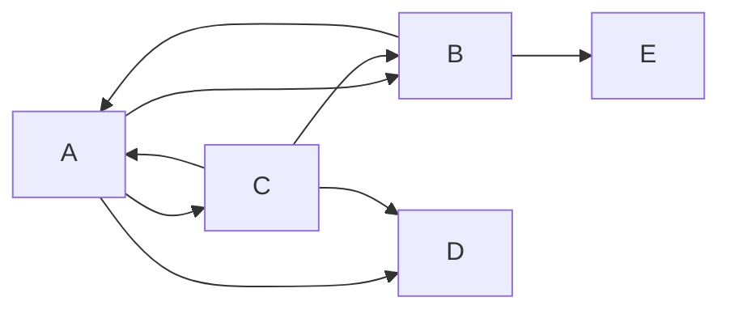

.md - 마크다운
마크다운은 엔터를 줄바꿈으로 인정하지 X

엔터가 두 번 되어야 다른 문단으로 인식

공백두번(..)
같은 문단 내 줄바꿈으로 인식

문단 줄바꿈
문단 내 줄바꿈<br>줄바꿈

# 제목1
#바로붙으면. #다음에 숫자를 붙여서 이슈호출이나 연관기능으로 사용<br>
옵시디언, 메모 앱들은 # 다음으로 태그로 씀<br>
(노션, 슬랙, 디스코들... #???)
## 제목2
### 제목3
#### 제목4
##### 제목5
###### 제목6
####### 7개부터는 안 붙음

___
---
#ㄴ 이건 구분선

순서 없는 리스트
- 순서가 없음
- 내가 좋아하는 건
    - 수박
    - 고기
탭등을 사용한 들여쓰기

* 별표도 된다
+ 플러스도 됩니다

1. 하이
2. 바이
33. 굿굿
93. 꺄하<br>
VIEW로 보면 순차 숫자로 나온다 => 걍 1.로 통일하는게 제일 편하다~


- [] 체크박스? - github issue, readme 해석시 특수문법
- [x] 이건 체크된 것
<!-- ctrl+/ 하면 주석처리 -->

*기울이기*
_기울이기_

**굵게**<br>
~~취소선~~<br>
<mark>형광펜<br>
태그</mark><br>
'~~취소선~~'<br>
' ' - 인라인 코드<br>
```
코드박스
123456789
```

```python
print("hello world")
```




> 인용
>> 인용 안에 인용
>>> 인용 안에 인용 안에 인용

>여러분들 스트레칭하세요
>- 지나가던 프로그래밍 아저씨

<!-- 이스케이프 문자 -->

[연결하고 싶은 문자](http://naver.com)


[](http://naver.com)


'|(수직바, 파이프라인)'

|제목1|제목2|제목3|
|----|----|----|
|하이|메롱|바이
|캬캬|하하|키키|
|냥냥이|멍멍이|멍냥이|

#왼쪽 정렬이 기본값이고 <br>오른쪽 정렬 하고 싶으면 |---:|로 하면 되고 <br>가운데 정렬은 |:---:|
